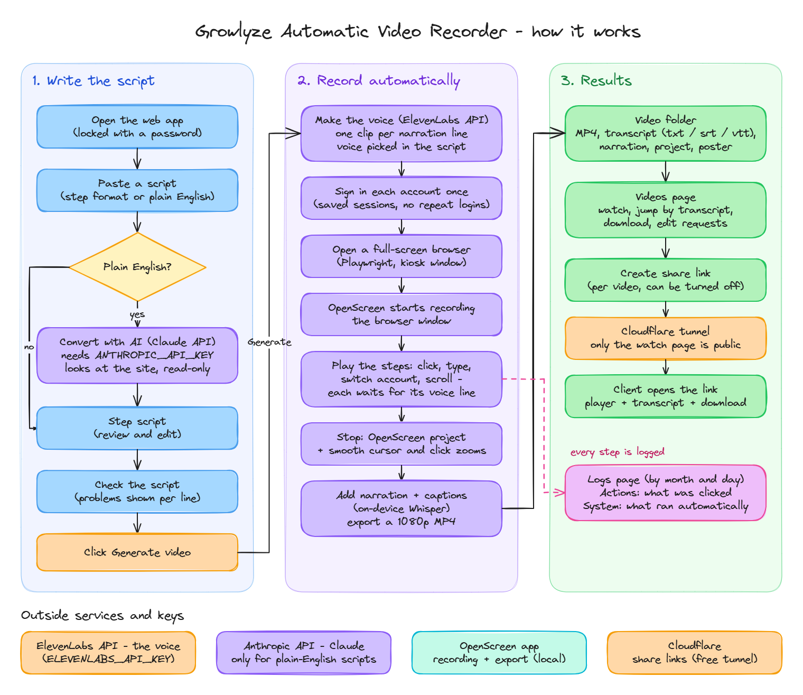

# Growlyze Automatic Video Recorder

Automated product demo videos without recording by hand. You write a script: a URL, the
steps to perform, and one line of narration per step. The tool opens the page, performs the
steps, records the screen with [OpenScreen](https://github.com/getopenscreen/openscreen),
adds an AI voiceover ([ElevenLabs](https://elevenlabs.io)) timed to each step, and exports a
finished 1080p MP4 with a smooth cursor, zooms on clicks, captions and a transcript.

It replaces recording Loom videos manually. Everything runs on your own Windows PC.



*The editable diagram is [docs/flowchart/system-flowchart.excalidraw](docs/flowchart/system-flowchart.excalidraw)
(open it at excalidraw.com). Rebuild the PNG with `node docs/flowchart/build-flowchart.mjs`.*

**Features**

- **Script to video in one command** (`npm run make -- videos/example.json`) or one click
  in the web interface.
- **AI voiceover** from ElevenLabs. The person writing the script picks the voice, with
  previews. Without an API key it falls back to the free Windows offline voice.
- **Voice and actions in sync:** each step lasts as long as its narration line.
- **Polished output:** a smooth animated cursor, automatic zooms on clicks, a background
  frame, and optional burned-in captions.
- **Transcripts:** the exact script text with timestamps, as .txt, .srt and .vtt.
- **Web interface:** write scripts, generate, watch and download videos, jump through steps,
  and leave timestamped edit requests.
- **Password lock** on the web interface.
- **Share links:** a public watch page per video (player, transcript, download) through a
  Cloudflare tunnel. You can turn each link off.
- **Clear errors**, e.g. which step's selector wasn't found, with a screenshot.

## Quick start

Requirements: Windows 10/11, [Node.js 18+](https://nodejs.org),
[ffmpeg](https://ffmpeg.org) (`winget install Gyan.FFmpeg`),
[OpenScreen 2.1+](https://github.com/getopenscreen/openscreen)
(`winget install --source msstore OpenScreen`), and Google Chrome or Microsoft Edge.

```
git clone https://github.com/growlyze/Automation-for-loom-Recording.git
cd Automation-for-loom-Recording
npm install
copy .env.example .env      # then set UI_PASSWORD and, optionally, the ElevenLabs key
npm run ui                  # web interface at http://localhost:4400
```

Or from the command line:

```
npm run make -- videos/example.json
```

Result: `output/<title>/<title>.mp4`.

## Lock (password)

The web interface opens on a sign-in page. Set the password in `.env`:

```
UI_PASSWORD=your-password
```

- The password is only in `.env`, which is never committed. Changing it signs everyone
  out.
- A sign-in lasts 7 days (`UI_SESSION_DAYS`). **🔒 Lock** in the header signs out.
- After 5 wrong attempts in 10 minutes, sign-in pauses for a minute.
- Share links are not locked: each one opens only its own video, by design.
- If `UI_PASSWORD` is empty, the interface is not locked and the server prints a warning.

## Web interface

```
npm run ui
```

Then open **http://localhost:4400**. It only listens on this computer (`127.0.0.1`).

- **+ New video:** paste a script into the box (or **Open file…** for a .txt or .json),
  pick a voice, and click **Generate video**. As you type, the right-hand panel checks the
  script: it lists the steps it understood or names each line that has a problem.
  **Generate** is enabled once the script is valid. Prefer a form? Use **Build step by step
  instead**. Progress streams into the panel at the bottom. Only one video records at a
  time, because recording takes over the screen.
- **Videos:** every generated video, with a preview. Open one to:
  - watch it, with a step list you can click to jump to that step;
  - download the MP4, narration, log or timings;
  - **Edit script** and **Re-generate**;
  - add **edit requests**: a note tied to the current playback time and, if you like, a step.
    Mark them done once handled. They're saved in `edit-requests/<video>.json`, so
    re-generating a video keeps them. To have Claude Code make the changes, ask it to
    *"apply the open edit requests for &lt;video&gt;"*.
- The header shows which voice is in use (ElevenLabs or the Windows fallback) and whether
  public sharing is on.

Set `UI_PORT` in `.env` to use a port other than 4400.

## Logs

Every run is kept in `logs/<YYYY-MM>/<YYYY-MM-DD>/<time>-<video>.log`, with a one-line
summary per run in `logs/runs.jsonl`. These stay on this PC and are git-ignored. Each line
is one of two kinds:

- **`[ACTION]`:** what happened on screen, in plain words, with the time in the video:
  `[0:05] Step 2 · Typed "Record the product demo" into "What needs to be done?"`,
  `Clicked "Payments"`, `Switched to account "admin"`, `Said: "…"`, and skipped optional
  steps.
- **`[SYSTEM]`:** what ran automatically: voice generation, account sessions, recording,
  zooms, captions, export and errors.

The **Logs** page in the web interface lists runs by month, then day (date, time, video,
succeeded/failed, how long it took, the error). It can filter by result and search. Opening
a run shows its log with **Actions**, **System** and **All** tabs, plus links to the video,
the script and a download.

## Transcripts

Each video gets `transcript.txt`, `transcript.srt` and `transcript.vtt` in its output
folder. The text is the script's exact narration, not a speech-to-text guess, timed to when
each line is spoken. In the web interface, the **Transcript** tab beside the player
highlights the line being spoken, jumps to a line when you click it, and offers Copy and
downloads. The player's CC button shows the same text as subtitles.

## Share links

On a video's page, click **Create share link**. Anyone with the link sees a clean page with
just that video, its transcript and download buttons. It never gives access to the editor,
your scripts or other videos.

- The share pages run on their own port (4401). Only that port is published through a
  Cloudflare tunnel (`cloudflared`). The editor on 4400 stays private to this PC.
- Videos stream from this PC. **A link works only while this PC is on and `npm run ui` is
  running.**
- **Turn off link** disables it at once. Creating a link again gives a new address.
- The page counts views (link-preview bots excluded) and isn't indexed by search engines.
- Links are kept in `shares.json`, which is git-ignored: whoever has a token can watch.

### Free address vs permanent address

With no settings, the tunnel uses Cloudflare's free "quick tunnel": a random
`https://<words>.trycloudflare.com` address that **changes every time the UI restarts**,
so links you've sent stop working after a restart. For links that never change:

1. Create a free Cloudflare account and add a domain you own.
2. In Cloudflare: **Zero Trust > Networks > Tunnels > Create a tunnel** (type Cloudflared).
   Copy the token from the install command it shows.
3. Under **Public Hostname**, add e.g. `videos.yourdomain.com` and point it to
   `http://localhost:4401`.
4. In `.env`, set `SHARE_TUNNEL_TOKEN=<token>` and
   `SHARE_BASE_URL=https://videos.yourdomain.com`, then restart `npm run ui`.

**If the free tunnel fails** with `failed to request quick Tunnel ... context deadline
exceeded`, Cloudflare's signup service (`api.trycloudflare.com`) is answering too slowly for
cloudflared's fixed 15-second limit on your connection. A permanent tunnel (above) doesn't
use that service.

## How it works

1. Reads and validates the input file.
2. Generates one narration clip per step (ElevenLabs, or the Windows offline voice until the
   key is set) and measures each clip's length. Clips are cached in `.cache/tts/`.
3. Opens the URL in a full-screen (kiosk) Chrome window and starts an OpenScreen recording
   of that window.
4. Runs the steps with Playwright. Each step's narration and action start together; the
   step lasts as long as the longer of the two, so voice and picture stay in line.
5. Stops the recording. OpenScreen turns it into a project.
6. Gives OpenScreen the logged pointer path (`setPointerTrack`). Playwright doesn't move the
   real mouse, so without this there would be no cursor and no click zooms.
7. Mixes the clips into one narration track at the measured step times and adds it as the
   voiceover. The recording has no sound of its own, so this is the only audio.
8. Optionally transcribes the voiceover on this machine (Whisper) and turns captions on.
9. Exports the MP4 and saves the project, audio, timings and a log.

The OpenScreen steps go through its MCP server (`openscreen mcp`), which the pipeline starts
and stops itself. The plain CLI can't set a pointer track or caption a voiceover.

## Setup details

1. **Node.js 18+** and **ffmpeg** on the PATH (`winget install Gyan.FFmpeg`).
2. **OpenScreen 2.1.0 or newer**: `winget install --source msstore OpenScreen`.
3. **Google Chrome** or **Microsoft Edge**.
4. In this folder: `npm install`.
5. `copy .env.example .env` and fill it in: at least `UI_PASSWORD`; the ElevenLabs key is
   optional (see below).

The pipeline finds OpenScreen on its own (the Store's `openscreen.exe` alias, or the
standalone installer's folders). Set `OPENSCREEN_EXE` in `.env` if it can't.

## Saved logins (no passwords in scripts)

### Use a site you're already signed into in Chrome

For sites already signed in in your own Chrome (e.g. make.com with your Google account):

1. One time per Chrome profile: install the extension in `chrome-extension/`.
   `chrome://extensions` → **Developer mode** → **Load unpacked** → choose that folder.
2. **Logins** page → **Use a login from your Chrome**: pick the Google account (your
   Chrome profiles are listed with their emails), enter the site and a name (e.g. `make`) →
   **Open in my Chrome**.
3. The site opens in that Chrome profile, already signed in. The extension copies that
   site's session (cookies and local storage) to the recorder, and the page shows
   "Saved ✓".

Or, on any site, click the extension's button, give a name, paste the code from the Logins
page once, and click **Save login**. The extension only sends to the recorder on
`localhost`, and only with that code.

### Or sign in once in a new window

Instead of writing `Account: admin | email | password` in a script, sign in once:

1. **Logins** page → enter the site address and a name (e.g. `admin`) → **Open Chrome and
   sign in**.
2. A normal Chrome window opens. Sign in however the site asks: email and password, Google,
   a 2-step code.
3. Click **Save login**. It refuses while the site still shows a sign-in form.

Scripts then just say `switch admin`, with no Account line and no password. Before each
recording, the saved login is checked. If the site has signed it out, the run stops with a
message to click **Sign in again**. Each login keeps its own Chrome profile in
`.cache/logins/` (git-ignored, this PC only), so Google stays signed in there and signing in
again is usually one click. **Convert with AI** uses saved logins too, for accounts a
plain-English script names without a password.

You can't reuse your everyday Chrome login directly: Chrome blocks automation of its main
profile and encrypts its cookies to it. That's why the recorder keeps its own signed-in
profile per login.

## Plain-English scripts (Convert with AI)

Paste a script written for a person, such as a Loom script with roles, "Say:" lines and
"Click Payments", and the page offers **✨ Convert with AI**. Claude (Opus 5.5):

1. reads the script: accounts, sections, what to click and type, the narration;
2. opens the site in a hidden browser on this PC, signs each account in once (reusing saved
   sessions), and looks at every page the script visits to find a working selector for each
   button and field. It also checks forms for required fields and notices content below the
   fold that needs a scroll;
3. writes the steps. Narration stays word for word. The result has to pass the same checks
   as a pasted script.

The steps replace the text in the box so you can review them before **Generate video**.
**Your original plain-English script** (below the box) puts the original back. Progress
streams on the page, and each conversion is saved on the Logs page with its Actions and
cost.

- **Read-only:** while converting, Claude can only open pages and dialogs. The click tool
  refuses anything that submits or changes data (Start, Send, Save, Delete, …), so
  converting never changes the site. The real actions only happen when the video is
  recorded.
- **Key:** set `ANTHROPIC_API_KEY` in `.env` (console.anthropic.com → API Keys), then restart
  the UI. One conversion typically costs $0.50–$2 and takes 2–5 minutes.
- Server-side refusal fallback is enabled (`fallbacks: "default"`): if the model declines a
  request, the API retries it on a fallback model automatically.

## Script format for pasting

The **+ New video** box takes JSON (below) or this simpler text format:

```
Title: How to sign up
URL: https://example.com
Captions: on

goto https://example.com | Welcome! Let's sign up.
click text=Sign up | Click Sign up at the top.
type #email "demo@test.com" | Enter your email.
press Enter
scroll #pricing | Here are the plans.
wait 1500 | And you're in.
say Thanks for watching!
```

- Settings first: `Title:` (required), `URL:` (defaults to the first `goto`), and optionally
  `Captions: on/off`, `Resolution:` and `Voice:` (a voice ID; the voice list on the page is
  easier).
- One step per line. The text after ` | ` is what the voice says during that step.
- Steps: `goto <url>`, `click <element>`, `type <element> "text"`, `press <key>`,
  `hover <element>`, `scroll <element>` or `scroll <pixels>`, `wait <ms>` (or `wait 2s`),
  and `say <text>` (narration with no action).
- Lines starting with `#` are notes and are ignored.

## Writing an input file

Put one JSON file per video in `videos/`:

```json
{
  "title": "How to sign up",
  "url": "https://example.com",
  "resolution": "1920x1080",
  "captions": true,
  "steps": [
    { "action": "goto",  "url": "https://example.com", "say": "Welcome! Let's sign up." },
    { "action": "click", "selector": "text=Sign up",   "say": "Click Sign up at the top." },
    { "action": "type",  "selector": "#email", "text": "demo@test.com", "say": "Enter your email." },
    { "action": "press", "key": "Enter" },
    { "action": "wait",  "ms": 1500, "say": "And you're in." }
  ]
}
```

| Field | Required | Meaning |
|---|---|---|
| `title` | yes | Video name; also the output folder name |
| `url` | yes | Page the browser opens before recording starts |
| `resolution` | no | `1920x1080` (default), `1280x720` or `source` |
| `captions` | no | `true` to burn captions of the narration into the video (default `false`) |
| `fps` | no | `24`, `30` (default) or `60` |
| `voice` | no | ElevenLabs voice ID of the narrator for this video. Empty = the default `ELEVENLABS_VOICE_ID` from `.env` |

### Choosing the voice

Whoever writes the script picks the narrator. In the web interface, the script editor has
a **Voice** list with every voice on the ElevenLabs account: your own (cloned or
professional) voices first, then ElevenLabs' standard voices. **▶ Preview** plays a sample.
Leave it on **Default** to use the voice in `.env`.

In a JSON file, set `"voice": "<voice id>"`. `npm run voices` lists the IDs. The video's
page shows which voice was used. Changing the voice and re-generating creates the narration
again, which uses ElevenLabs characters.

### Steps

Every step can have `say` (its narration line) and `pause` (extra milliseconds to hold
afterwards).

| Action | Fields | What it does |
|---|---|---|
| `goto` | `url` | Opens a page |
| `click` | `selector` | Moves the cursor to the element and clicks it |
| `type` | `selector`, `text`, optional `delay` (ms per key, default 60) | Clicks the field and types like a person |
| `press` | `key` | Presses a key: `Enter`, `Tab`, `Escape`, `ArrowDown`, `Control+A`... |
| `hover` | `selector` | Moves the cursor over an element |
| `scroll` | `selector` or `y` | Scrolls smoothly to an element, or by `y` pixels |
| `wait` | `ms` | Holds still (or as long as its `say` takes, if longer) |

Selectors use Playwright syntax: CSS (`#email`, `.btn-primary`), text (`text=Sign up`),
roles (`role=button[name="Save"]`), and chaining (`.todo-list li >> nth=0 >> .toggle`).
To find one, open the page in Chrome, right-click the element, and choose **Inspect**.

Tips:
- Keep each `say` short, one sentence per action.
- Leave about 3 s between clicks that should each get their own zoom. Closer clicks share one.
- The browser starts with a fresh profile (not logged in, no cookies). For a page behind a
  login, add the login steps to the file. Use a demo account, since the steps show on screen.

## Running

```
npm run make -- videos/example.json
npm run make -- videos/example.json --captions      # force captions on
npm run make -- videos/example.json --no-captions   # force captions off
```

**While it records, don't touch the mouse or keyboard**, and keep the kiosk window in front.
The run takes about the video's length, plus ~20 s to export. The first captioned run also
downloads OpenScreen's speech model (~264 MB) once.

### Output: `output/<title>/`

| File | |
|---|---|
| `<title>.mp4` | The finished video |
| `narration.wav` | The voiceover track, timed to the video |
| `clips/` | One narration clip per step |
| `project/` | The OpenScreen project with its recording, pointer track and narration |
| `timeline.json` | When each step started and how long its action and narration took |
| `log.txt` | Full log of the run |
| `failure.png` | Only after a failed step: the browser at the moment it failed |

Re-running the same file replaces its output folder.

To touch up a video by hand, open OpenScreen. The project is in its project list under the
video's title, where you can move zooms, edit captions and export again.

## Adding the ElevenLabs key later

1. `copy .env.example .env`
2. In `.env`, set `ELEVENLABS_API_KEY=` to your key and `ELEVENLABS_VOICE_ID=` to the
   **default** voice ID (`npm run voices` lists them). Each script can choose another voice.
3. Run `npm run make -- videos/example.json` again.

The log line `Voice: ElevenLabs (...)` confirms the switch. With the key empty, the pipeline
uses the Windows voice. `.env` is in `.gitignore`, and the key is never printed or logged.
Clips are cached, so re-running a file only pays for lines whose text changed.

## Error messages

| Message | Fix |
|---|---|
| `OpenScreen is not installed` | `winget install --source msstore OpenScreen`, or set `OPENSCREEN_EXE` |
| `The input file ... has problems` | Lists every problem in the JSON, with an example of each step |
| `Step N (click): selector not found` | The selector matched nothing within 10 s. Check it in the page. See `failure.png` |
| `ElevenLabs returned 401` | Wrong or revoked key |
| `ElevenLabs returned 404` | `ELEVENLABS_VOICE_ID` is not a voice on that account |
| `ffmpeg was not found` | `winget install Gyan.FFmpeg`, or set `FFMPEG` |

When a step fails, the recording is stopped cleanly. It stays in OpenScreen's project list
with "(failed)" in its title, where you can delete it.

## Notes

- **VS Code terminals** set `ELECTRON_RUN_AS_NODE=1`, which makes OpenScreen act like plain
  Node. The pipeline removes it when it starts OpenScreen. If you run `openscreen.exe` by hand
  from VS Code, run `Remove-Item Env:ELECTRON_RUN_AS_NODE` first.
- **Store install paths:** the Store build saves recordings under
  `%LOCALAPPDATA%\Packages\EtienneLescot.OpenScreen_*\LocalCache\Roaming\openscreen\`,
  although it reports them as `%APPDATA%\openscreen\...`. The pipeline handles this.
- `openscreen pack` only accepts older-format projects, so the pipeline copies the project
  and its media into `project/` itself.
- OpenScreen's CLI and project format can still change between releases. Re-test after
  updating OpenScreen.

## Files

```
src/make.mjs        the pipeline (npm run make)
src/ui-server.mjs   web interface server (npm run ui)
src/auth.mjs        password lock: sign-in page, signed session cookie
src/share.mjs       share links, public watch page server, Cloudflare tunnel
src/transcript.mjs  transcript as text, SRT and VTT
src/http-util.mjs   file streaming helpers
ui/index.html       web interface page
edit-requests/      edit requests per video (kept across re-generations)
src/input.mjs       input file validation
src/tts.mjs         ElevenLabs / Windows voice, with cache
src/browser.mjs     kiosk browser, step actions, pointer log
src/openscreen.mjs  finding OpenScreen, CLI and MCP client
src/env.mjs         .env loader
scripts/smoke.mjs   10-second record + export check (npm run smoke)
scripts/mcp-tools.mjs  lists OpenScreen's MCP tools (npm run mcp-tools -- <name>)
videos/example.json the sample video
videos/tests/       inputs that should fail, for checking error messages
```
